# AzureFlow

AzureFlow is an automated, containerized reference CI/CD pipeline and web application deployed on Microsoft Azure. Built with Next.js 16 and React 19, the project demonstrates a complete DevOps lifecycle—from source code tracking in Azure Repos (imported from GitHub) through automated testing, multi-stage Docker containerization, Azure Container Registry (ACR) image hosting, and automated continuous deployment to Linux Azure App Service.

---

## Live Website

The production AzureFlow web application is deployed and running on Azure App Service:

* **Live URL:** [https://geeth-nextjs-app-aye9bte2fgeqh9f7.westus3-01.azurewebsites.net](https://geeth-nextjs-app-aye9bte2fgeqh9f7.westus3-01.azurewebsites.net)
* **Status:** Verified and actively serving traffic via Azure App Service default domain.

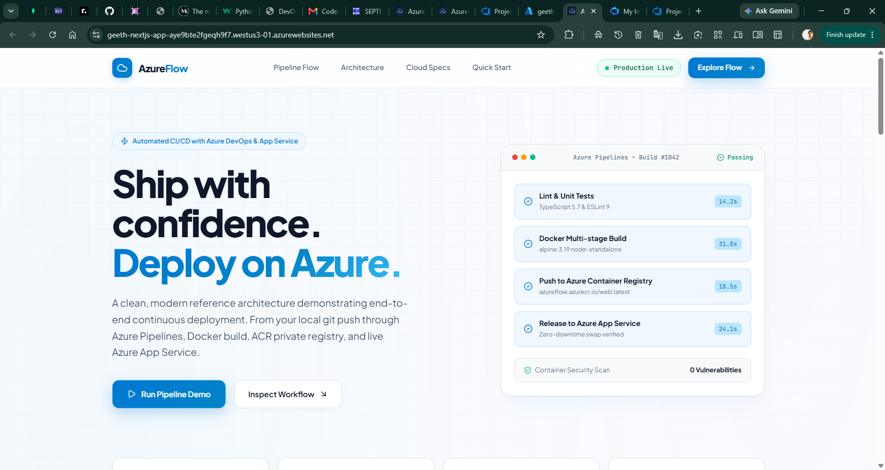
*Production AzureFlow application running live on Azure App Service.*

---

## Project Overview

AzureFlow was created as a practical, hands-on DevOps demonstration project to design, implement, and validate an automated, container-based CI/CD pipeline using Microsoft Azure cloud services and Azure DevOps.

The application itself is a lightweight, responsive Next.js frontend designed to showcase the deployment architecture and CI/CD metrics. To maintain a strict and clean DevOps focus, the application intentionally contains:

* **No backend or server-side API dependencies**
* **No database**
* **No user authentication**

By isolating infrastructure from application-layer business logic, the project serves as a clear, repeatable reference architecture for automated cloud deployments.

---

## Project Objectives

This project delivers practical experience across core DevOps disciplines:

* **Continuous Integration (CI):** Automating code checkout, runtime provisioning, dependency caching, and build verification.
* **Continuous Deployment (CD):** Automating container releases directly to Azure App Service upon successful image creation.
* **Docker Containerization:** Building optimized, multi-stage production container images with minimal attack surfaces.
* **Container Image Registries:** Managing private container repositories in Azure Container Registry (ACR).
* **Cloud Native Hosting:** Deploying and configuring Linux containers on Azure App Service (Free F1 tier).
* **Azure DevOps Pipelines:** Designing and managing declarative YAML pipelines with automated triggers.
* **Identity-Based Security:** Configuring passwordless Service Connections via Workload Identity Federation (OIDC) and Azure Role-Based Access Control (RBAC).
* **Pipeline Monitoring & Troubleshooting:** Resolving real-world CI/CD challenges including runtime versioning, Linux native dependencies, and container port mapping.

---

## Architecture

The end-to-end architecture connects developer commits to live container instances on Azure through an automated pipeline:

```text
+-------------------------------------------------------------+
|                     Developer Workstation                   |
|              Source Code & Multi-Stage Dockerfile           |
+------------------------------+------------------------------+
                               |
                               v
+-------------------------------------------------------------+
|                         GitHub Repo                         |
|                 (Original Project Source)                   |
+------------------------------+------------------------------+
                               |
                               v (Imported repository)
+-------------------------------------------------------------+
|                         Azure Repos                         |
|      (dev.azure.com/.../Azure-DevOps-Project / main)        |
+------------------------------+------------------------------+
                               |
                               v (Automated trigger on commit)
+-------------------------------------------------------------+
|                        Azure Pipelines                      |
|                                                             |
|  1. Checkout: Fetch source code from Azure Repos            |
|  2. Setup Node.js: Provision Node.js 22.x runtime           |
|  3. Setup pnpm: Activate pnpm 12.3.4 via Corepack           |
|  4. Install Dependencies: Run frozen-lockfile installation  |
|  5. Build Next.js: Compile Next.js standalone assets        |
|  6. Docker Build: Multi-stage build using alpine runtime    |
|  7. ACR Push: Push image to geethdevops.azurecr.io          |
|  8. Deploy: Release container to geeth-nextjs-app App Svc   |
+--------------+-------------------------------+--------------+
               |                               |
               | (Pushes Docker Image)         | (Triggers Release)
               v                               v
+-------------------------------+   +-------------------------+
|   Azure Container Registry    |   |    Azure App Service    |
|   Registry: geethdevops       |   |  geeth-nextjs-app       |
|   Image: nextjs-app:latest    |   |  Linux (Free F1 Plan)   |
+--------------+----------------+   +------------+------------+
               |                                 ^
               +----------- Pulls Image ---------+
                           (via AcrPull MI)
                                                 |
                                                 v
                                    +-------------------------+
                                    |   Live Web Application  |
                                    |   Default Domain / Port |
                                    +-------------------------+
```

> **Repository Note:** GitHub served as the original source and initial import repository. The active Azure DevOps CI/CD pipeline triggers and builds directly from the imported **Azure Repos** repository (`Azure-DevOps-Project`).

---

## Technologies

| Category | Technology | Purpose |
| :--- | :--- | :--- |
| **Application Framework** | Next.js 16.3.3 | React web application framework with standalone output |
| **UI Library** | React 19 | Frontend user interface components |
| **Language** | TypeScript 5.7.3 | Static typing and compile-time validation |
| **Package Manager** | pnpm 12.3.4 | Fast, disk-efficient package manager managed via Corepack |
| **Containerization** | Docker | Multi-stage container build targeting Alpine Linux |
| **Source Repositories** | GitHub & Azure Repos | GitHub as initial source; Azure Repos as the active pipeline repository |
| **CI/CD Platform** | Azure Pipelines | Automated cloud build, test, container packaging, and release agent |
| **Container Registry** | Azure Container Registry (ACR) | Private, secure storage for Docker images (`geethdevops.azurecr.io`) |
| **Cloud Hosting** | Azure App Service | Managed Linux container platform running on the Free F1 tier |
| **Security & Identity** | Entra ID & Managed Identities | Workload Identity Federation (OIDC) and Azure RBAC (`AcrPush`, `AcrPull`) |

---

## CI/CD Workflow

The Azure Pipeline automates the build and deployment process through orchestrated steps:

1. **Repository Checkout:**
   Triggered on any push or merge to the `main` branch of Azure Repos (`Azure-DevOps-Project`).
2. **Node.js Environment Provisioning:**
   Provisions Node.js `22.x` on the `ubuntu-latest` hosted build agent using `UseNode@1`.
3. **Package Manager Initialization:**
   Enables Node Corepack and activates `pnpm@12.3.4` for deterministic package resolution.
4. **Dependency Installation:**
   Executes `pnpm install --frozen-lockfile` to ensure installed packages strictly match `pnpm-lock.yaml`.
5. **Next.js Standalone Build:**
   Executes `pnpm build` to compile the application and produce lightweight standalone outputs (`output: 'standalone'` in `next.config.mjs`).
6. **Docker Build & Push to ACR:**
   Invokes the `Docker@2` task using the project's `dockerfile` to build the production image and push it to `geethdevops.azurecr.io/nextjs-app:latest`.
7. **Continuous Deployment to App Service:**
   Executes the `AzureWebAppContainer@1` deployment task, instructing Azure App Service `geeth-nextjs-app` to pull the latest container image from ACR and restart the container without downtime.

---

## Docker Containerization

The containerization strategy uses a multi-stage Docker build configured in `dockerfile` (lowercase filename, referenced directly by the pipeline):

### Multi-Stage Architecture

* **Build Stage (`node:22-alpine`):**
  * Enables Corepack and runs `pnpm install` against cached dependency manifests (`package.json`, `pnpm-lock.yaml`).
  * Copies source code and executes `pnpm run build` to compile Next.js standalone assets.
* **Runtime Stage (`node:22-alpine`):**
  * Runs in production mode (`NODE_ENV=production`).
  * Copies only necessary standalone runtime artifacts:
    * `/app/public` → `./public`
    * `/app/.next/standalone` → `./`
    * `/app/.next/static` → `./.next/static`
  * Exposes container port `3000`.
  * Launches the server with minimal overhead: `CMD ["node", "server.js"]`.

### Local Container Execution

To build and test the Docker container locally:

```bash
# Build container image using the repository's dockerfile
docker build -f dockerfile -t azure-cicd-app .

# Run container instance locally on port 3001
docker run -d --name azure-cicd-app -p 3001:3000 azure-cicd-app
```

---

## Azure Container Registry

Azure Container Registry (ACR) serves as the secure, private registry for AzureFlow container images:

* **Registry Name:** `geethdevops`
* **Login Server:** `geethdevops.azurecr.io`
* **Repository:** `nextjs-app`
* **Resource Group:** `rg-azure-devops-cicd`
* **Pricing Tier:** `Standard`
* **Networking:** Public network access enabled with standard global IPv4 endpoint.
* **Encryption:** Microsoft-managed service encryption at rest protecting stored container layers.

The registry receives newly built images pushed by Azure Pipelines upon every successful commit to `main`.

---

## Azure App Service

Azure App Service hosts the live containerized Next.js web application on a managed Linux compute instance:

* **Web App Name:** `geeth-nextjs-app`
* **Resource Group:** `rg-azure-devops-cicd`
* **Operating System:** `Linux`
* **App Service Plan:** `ASP-rgazuredevopscicd-981b`
* **Pricing Tier:** `Free F1`
* **Container Image:** `geethdevops.azurecr.io/nextjs-app:latest`
* **Container Port:** `3000`
* **Default Domain:** `geeth-nextjs-app-aye9bte2fgeqh9f7.westus3-01.azurewebsites.net`

The App Service automatically pulls the updated Docker image from ACR and refreshes the container execution environment upon deployment.

---

## Authentication and Security

The deployment architecture follows modern zero-secret, identity-based security practices:

* **Azure DevOps Service Connection (`Azure-DevOps-CICD`):**
  * Type: Azure Resource Manager
  * Authentication: **Workload Identity Federation** using OpenID Connect (OIDC) backed by Microsoft Entra ID App registration.
  * Eliminates static service principal client secrets, passwords, or certificate rotations.
* **Role-Based Access Control (Azure RBAC):**
  * **`AcrPush`:** Granted to the Azure DevOps pipeline identity on the `geethdevops` registry, permitting automated image pushes during CI.
* **Managed Identity Integration:**
  * Azure App Service `geeth-nextjs-app` is configured with a User-Assigned Managed Identity.
  * The Managed Identity is assigned the **`AcrPull`** role on the `geethdevops` container registry, allowing App Service to pull private images securely without storing admin credentials.

---

## Pipeline Monitoring and Troubleshooting

The project demonstrates hands-on monitoring in Azure DevOps and documents key technical adjustments made during implementation:

* **Node.js & pnpm Version Alignment:**
  Configured Node.js `22.x` and `pnpm@12.3.4` across both the Azure Pipelines hosted runner and the Docker Alpine build environment to prevent lockfile synchronization mismatches.
* **Linux Platform Dependencies:**
  Handled Linux architecture native dependencies in the pipeline build step using `--frozen-lockfile --force` when platform-specific binaries required explicit installation.
* **CI Build Engine:**
  Next.js build was executed using standard Webpack compilation in the CI pipeline runner to ensure reliable, headless Linux agent compatibility.
* **Dockerfile Case Sensitivity:**
  Maintained strict case alignment with the repository's lowercase `dockerfile` filename across pipeline task arguments and Docker CLI commands to ensure cross-platform compatibility on Linux hosts.
* **Zero-Secret Registry Permissions:**
  Replaced traditional admin credential access with granular Azure RBAC (`AcrPush` for pipeline runner, `AcrPull` for App Service managed identity), adhering to least-privilege principles.
* **Container Port Routing:**
  Explicitly mapped the container listening port (`3000`) within App Service configuration to ensure HTTP traffic successfully resolves to the Next.js standalone server.

---

## Application Version

The application code incorporates a version identifier for end-to-end CI/CD verification:

```text
Current Version: v1.0.0
```

### CI/CD Verification Mechanism

Changing the application version in code serves as an end-to-end verification trigger:

```text
v1.0.0  ──(git commit & push)──>  Azure Pipelines  ──>  Docker & ACR  ──>  App Service  ──>  Live UI (v1.0.1)
```

When a developer increments the version number and commits to Azure Repos, the pipeline automatically tests, builds, containerizes, and deploys the new release to Azure App Service. Once deployed, the updated version string becomes immediately visible on the live website, confirming that the entire CI/CD chain functioned successfully.

---

## Local Development

To run the application locally outside of Docker:

```bash
# Install dependencies
pnpm install

# Start local development server
pnpm dev
```

Open [http://localhost:3000](http://localhost:3000) in your browser.

### Production Build Locally

```bash
# Create production build
pnpm build

# Run production standalone server
pnpm start
```

---

## Project Evidence

All screenshots below represent the verified implementation steps captured directly from the project environment.

### Repository and Azure DevOps Setup

#### 1. Import GitHub Repository to Azure Repos

*GitHub repository successfully imported into Azure DevOps under the `Azure-DevOps-Project` repository.*

#### 2. Service Connection Configuration

*Configuring Azure Resource Manager service connection using Workload Identity Federation and Entra ID App registration.*

#### 3. Azure DevOps Service Connection Details
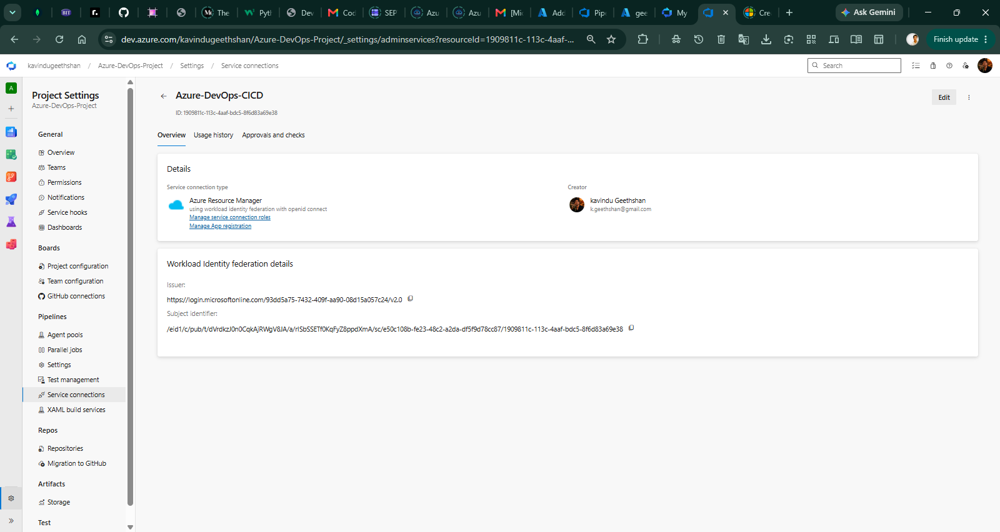
*Established `Azure-DevOps-CICD` service connection operating via OpenID Connect (OIDC) without static secrets.*

---

### Azure Container Registry

#### 4. ACR Configuration Basics
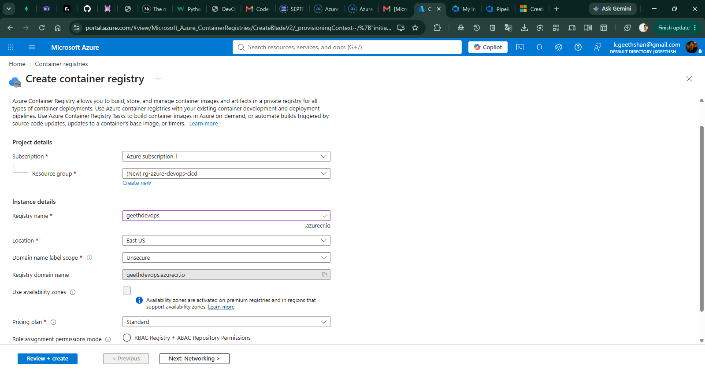
*Configuring the `geethdevops` Azure Container Registry on the Standard SKU in resource group `rg-azure-devops-cicd`.*

#### 5. ACR Networking Configuration
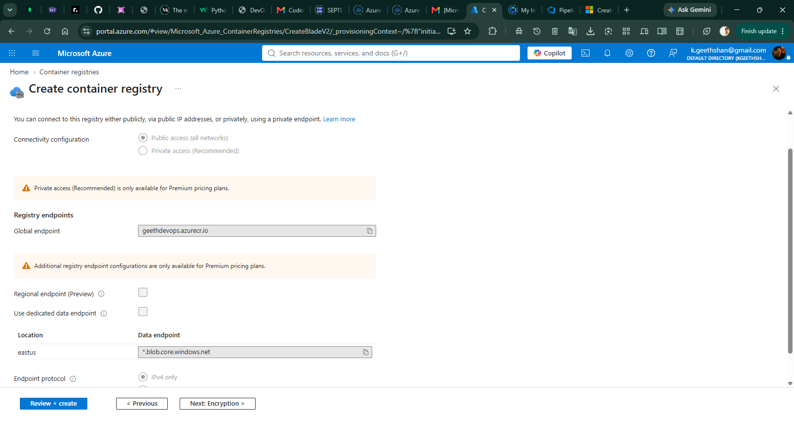
*Public network access configuration and global registry endpoint (`geethdevops.azurecr.io`).*

#### 6. ACR Encryption Configuration
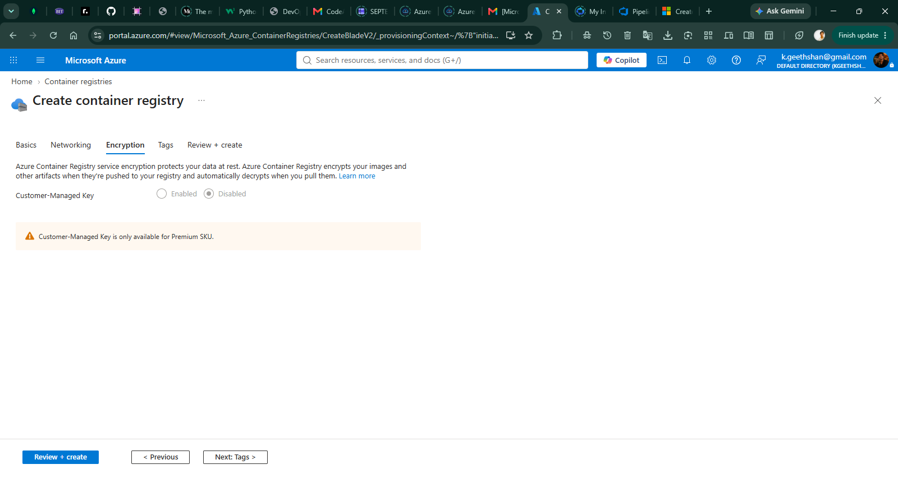
*Configuring Microsoft-managed service encryption at rest for registry image storage.*

#### 7. ACR Configuration Review
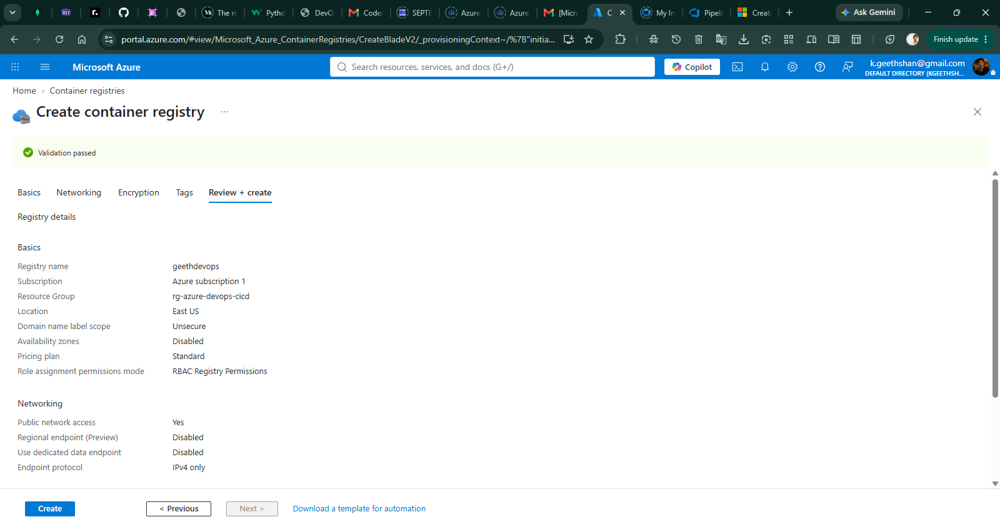
*Validation passed and configuration review before provisioning the Azure Container Registry.*

#### 8. ACR Successfully Created
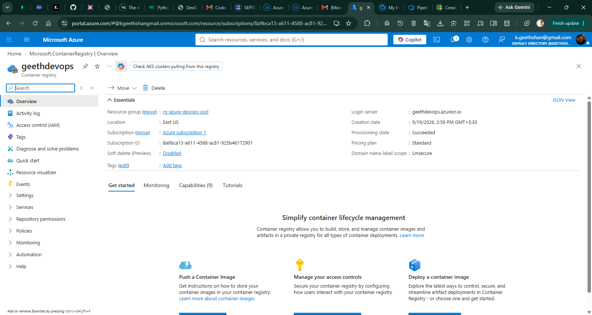
*Successfully provisioned `geethdevops` Azure Container Registry in Succeeded state.*

#### 9. ACR AcrPush Role Assignment
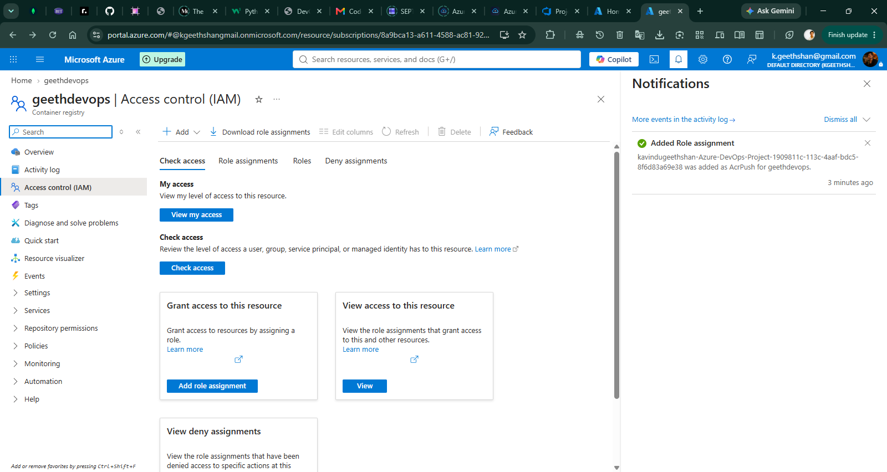
*Granting `AcrPush` RBAC role to the Azure DevOps pipeline identity on the `geethdevops` registry.*

---

### CI Pipeline

#### 10. Initial CI Pipeline Setup

*Initial pipeline YAML review and setup in Azure Pipelines.*

#### 11. Updating CI Pipeline for Next.js Build

*Updating `azure-pipelines.yml` to provision Node.js 22, pnpm, and execute standalone compilation.*

#### 12. Successful CI Pipeline Demonstration Run
.png>)
*Successful execution of initial demonstration run (#20260919.1) on the `main` branch.*

#### 13. Successful Docker-Based CI Pipeline Execution
.png>)
*Completed pipeline run (#20260919.12) validating dependency installation, Next.js build, and Docker multi-stage image creation.*

#### 14. Docker Image Build and Push to ACR
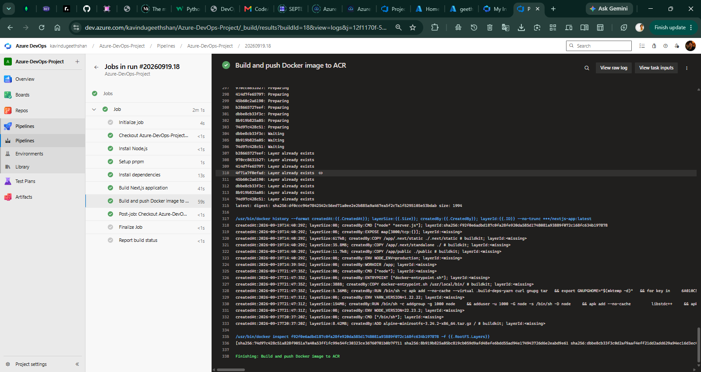
*Successful pipeline execution (#20260919.18) building and pushing Docker image layers to `geethdevops.azurecr.io/nextjs-app:latest`.*

---

### Azure App Service

#### 15. App Service Plan Review (Free F1)
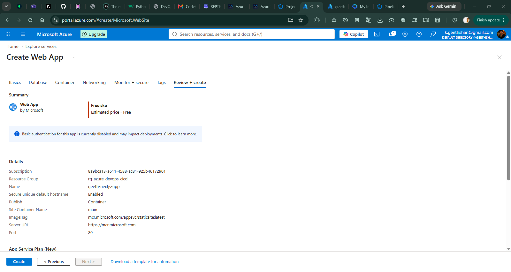
*Configuration review of the Linux App Service `geeth-nextjs-app` under the Free F1 pricing tier.*

#### 16. App Service Deployment Completed

*Azure Resource Manager template deployment completed successfully for the Web App resource.*

#### 17. App Service Overview

*Azure Portal overview showing running `geeth-nextjs-app` resource with container image configuration and default domain.*

#### 18. Automated Deployment to App Service
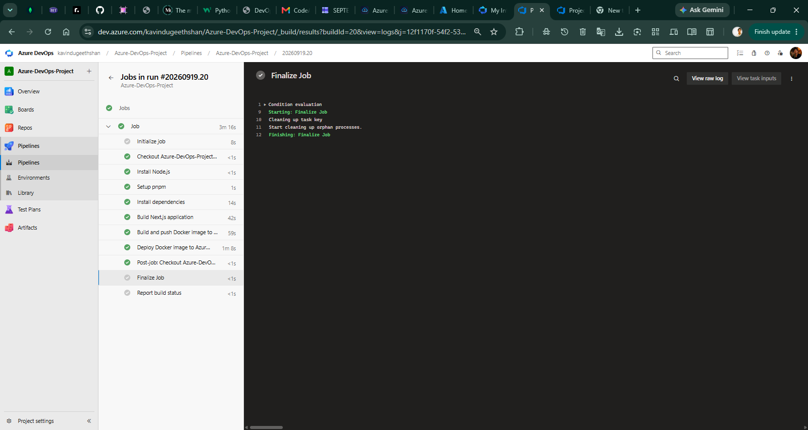
*Automated Continuous Deployment execution (#20260919.20) running `Deploy Docker image to Azure App Service`.*

---

### Containerization & Live Application

#### 19. Local Docker Container Verification

*Building and executing the multi-stage Docker container locally on port 3001 via PowerShell.*

#### 20. Production Live Website

*Live AzureFlow application successfully serving traffic from Azure App Service at default domain.*
